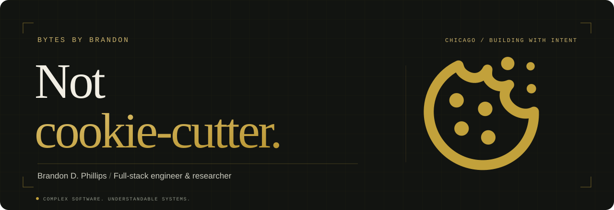

  <a href="https://www.bytesbybrandon.com/">The full picture</a> &nbsp; / &nbsp;
  <a href="https://www.bytesbybrandon.com/projects">The work</a> &nbsp; / &nbsp;
  <a href="https://www.bytesbybrandon.com/blog">Field notes</a> &nbsp; / &nbsp;
  <a href="mailto:brandon@bytesbybrandon.com">Say hello</a>

 

## I keep complex software understandable as it grows.

I'm **Brandon Phillips**, a full-stack engineer and researcher in **Chicago**.
I've spent **18 years shipping software**, and I care about what happens after launch: can the next person understand it?
Can they see what went wrong and recover?

That question takes me from production systems to agent tooling, and sometimes into research inspired by biology.

### A few bytes of my work

| Project | What you'll find |
| :--- | :--- |
| **[Reactive Skills](https://reactive-skills.com)** | A runtime for agent skills. |
| **[eventline](https://bytesbybrandon.github.io/eventline)** | A way to design systems around what happens. |
| **[AXI Toolkit](https://bytesbybrandon.github.io/axis/)** | Command-line tools built for agents and people. |
| **[Progressive Depth](https://bytequilt.github.io/progressive-depth/)** | Writing you can skim, read, or explore in depth. |
| **[ByteQuilt](https://www.bytequilt.com/)** | The software ecosystem I'm helping build. |
| **[Mutuus](https://mutuus.bytequilt.com/)** | Computing research inspired by biology. |

### What I look for in a system

- **State I can inspect.** I shouldn't have to guess what the software is doing.
- **Failures I can recover from.** A useful error tells me what to do next.
- **Code someone else can own.** Cleverness isn't much help if nobody can maintain it.

 

**Got a problem worth untangling?** [Let's talk.](mailto:brandon@bytesbybrandon.com)

The cookie is intentional. The cookie-cutter approach isn't.
